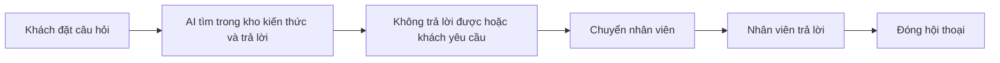

# Tổng quan nghiệp vụ — Chatbot Chăm sóc Khách hàng

> Mô tả demo này cho ai, giải quyết vấn đề gì. Cập nhật khi phạm vi thay đổi.

---

## 1. Thông tin chung

| Mục | Nội dung |
| :--- | :--- |
| Tên demo | Chatbot Chăm sóc Khách hàng |
| Mã dự án | `ai-chatbot-cskh` |
| Ngành / loại khách hàng | Doanh nghiệp nhận nhiều câu hỏi lặp lại (bán lẻ, dịch vụ, giáo dục) |
| Loại sản phẩm | Khung chat gắn vào website + web quản trị |
| Ý tưởng gốc | 10.1 · Chatbot chăm sóc khách hàng trên website (`ZDOCS/02-KE-HOACH/DANH-SACH-Y-TUONG.md`) |
| Người phụ trách | |
| Trạng thái | Mới tạo từ khuôn mẫu |

## 2. Vấn đề của khách hàng

- Nhân viên trả lời đi trả lời lại cùng một câu hỏi
- Ngoài giờ không ai trực
- Trả lời chậm nên mất khách

## 3. Giải pháp demo thể hiện

- Khung chat trên website, trả lời 24/7 bằng AI dựa trên kho câu hỏi thường gặp và thông tin sản phẩm
- Gợi ý sản phẩm phù hợp
- Chuyển sang nhân viên khi cần, nhân viên trả lời trong hộp thư chung
- Quản lý kho kiến thức, thống kê câu hỏi

## 4. Vai trò người dùng

| Vai trò | Mã | Dùng trên | Làm được gì |
| :--- | :--- | :--- | :--- |
| Khách | — | Website | Hỏi đáp qua khung chat |
| Quản trị viên | ADMIN | Desktop | Toàn quyền |
| Quản lý | MANAGER | Desktop | Kho kiến thức, báo cáo |
| Nhân viên CSKH | STAFF | Desktop | Nhận hội thoại được chuyển, trả lời |

## 5. Phân hệ và chức năng

| Area | Chức năng | Màn hình (route FE dự kiến) | Ưu tiên |
| :--- | :--- | :--- | :---: |
| `System` | Đăng nhập, tài khoản, vai trò, cài đặt | Có sẵn | — |
| `Chat` | Khung chat trên website | `/` (widget) | P1 |
| `Chat` | Trả lời tự động bằng AI | — | P1 |
| `Chat` | Kho kiến thức: câu hỏi thường gặp, sản phẩm | `/knowledge` | P1 |
| `Chat` | Chuyển nhân viên, hộp thư chung | `/inbox` | P1 |
| `Chat` | Lịch sử hội thoại | `/conversations` | P2 |
| `Chat` | Thống kê câu hỏi | `/reports` | P2 |

P1 = bắt buộc có để demo · P2 = nên có · P3 = làm thêm nếu còn thời gian.

## 6. Luồng nghiệp vụ chính

## 7. Phạm vi

**Có trong demo:**

- Chế độ mock: trả lời theo kịch bản có sẵn
- Chế độ API: gọi mô hình AI thật (cần API key trong .env)

**Không làm (nói rõ với khách nếu được hỏi):**

- Kết nối Messenger, Zalo OA thật
- Các kết nối bên ngoài khác chỉ giả lập

## 8. Dữ liệu mẫu cần chuẩn bị

| Dữ liệu | Số lượng | Ghi chú |
| :--- | :---: | :--- |
| Câu hỏi thường gặp | 50 |  |
| Sản phẩm | 30 |  |
| Hội thoại | ~400 | 90 ngày, có hội thoại chuyển nhân viên |
