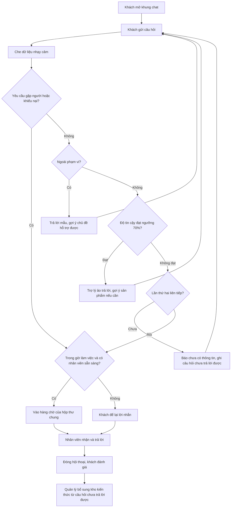
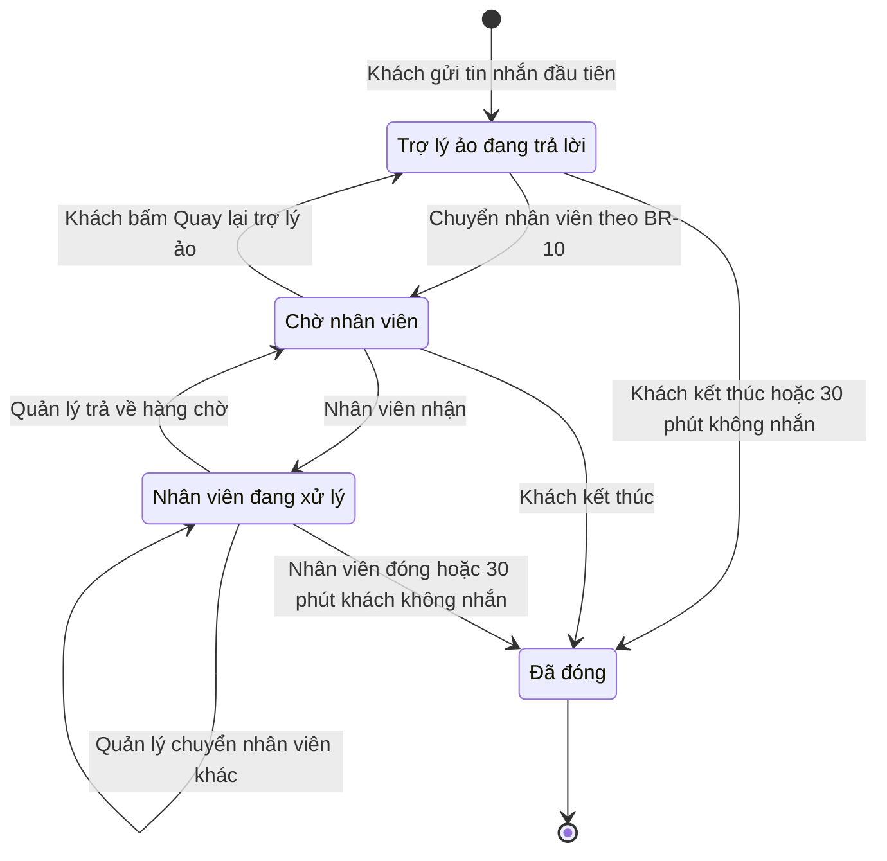
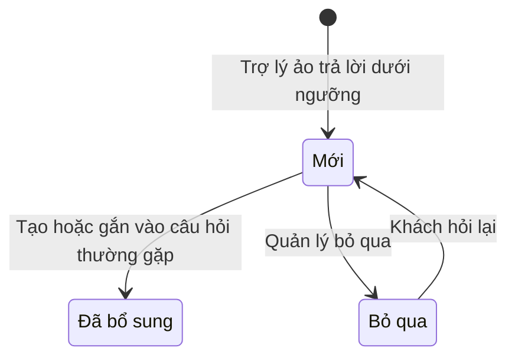

# Đặc tả yêu cầu phần mềm (SRS) — Chatbot Chăm sóc Khách hàng

| Phiên bản | Ngày | Trạng thái |
| :--- | :--- | :--- |
| 1.0 | 12/10/2026 | Bản nháp để triển khai demo |

> Cách viết, quy ước mã, mức độ chi tiết: `ZDOCS/05-HUONG-DAN/HUONG-DAN-VIET-TAI-LIEU-NGHIEP-VU.md`.
> Phần nền (đăng nhập, tài khoản, vai trò, cài đặt, đặt lại dữ liệu demo): `ZDOCS/03-KIEN-TRUC/USE-CASE-NEN.md`, không viết lại ở đây.

---

## 1. Giới thiệu

### 1.1. Mục đích

Tài liệu mô tả đầy đủ yêu cầu của bản demo Chatbot Chăm sóc Khách hàng: khung chat trên website, nguyên tắc trả lời của trợ lý ảo, chuyển nhân viên, hộp thư chung, kho kiến thức, thống kê, phân quyền và màn hình. Dev dùng để code, tester dùng để viết và chạy test case, sales dùng để biết demo làm được gì và không làm gì.

### 1.2. Phạm vi

**Trong phạm vi:** website mẫu của một cửa hàng có khung chat; trợ lý ảo trả lời 24/7 dựa trên kho kiến thức ở hai chế độ `mock` (kịch bản có sẵn) và `api` (gọi mô hình AI thật); gợi ý sản phẩm; chuyển nhân viên và lời nhắn ngoài giờ; hộp thư chung cho nhân viên CSKH; kho kiến thức (câu hỏi thường gặp, sản phẩm), thử câu hỏi, bổ sung từ câu hỏi chưa trả lời được; lịch sử hội thoại; tổng quan và thống kê; cấu hình chatbot.

**Ngoài phạm vi:** kết nối Facebook Messenger, Zalo OA, email (demo chỉ có khung chat trên website); gửi thông báo qua SMS, email; tra cứu đơn hàng, đặt hàng, thanh toán qua chat; đồng bộ giá, tồn kho với website hoặc phần mềm bán hàng; khách gửi ảnh, tệp, tin nhắn thoại; tự học từ tài liệu PDF, Word, website; nhiều website, nhiều thương hiệu, nhiều ngôn ngữ; tự phân hội thoại cho nhân viên; đoạn mã nhúng khung chat vào website khác.

### 1.3. Thuật ngữ

| Thuật ngữ | Giải thích |
| :--- | :--- |
| Khách | Người truy cập website, không đăng nhập, trò chuyện qua khung chat |
| Khung chat | Cửa sổ trò chuyện nổi ở góc website mẫu |
| Trợ lý ảo | Phần mềm AI tự trả lời trong khung chat; luôn xưng là trợ lý ảo, không xưng là người |
| Nhân viên CSKH | Người dùng vai trò `STAFF`, trả lời khách trong hộp thư chung |
| Kho kiến thức | Toàn bộ câu hỏi thường gặp và sản phẩm mà trợ lý ảo được phép dùng để trả lời |
| Mục kiến thức | Một câu hỏi thường gặp hoặc một sản phẩm trong kho kiến thức |
| Câu hỏi thường gặp | Cặp câu hỏi và câu trả lời chuẩn của cửa hàng, kèm các cách hỏi khác và từ khóa |
| Cách hỏi khác | Các câu khách hay dùng để hỏi cùng một ý, vd "phí ship bao nhiêu" cho câu "Phí giao hàng bao nhiêu?" |
| Hội thoại | Một phiên trò chuyện của khách, từ tin nhắn đầu tiên tới khi đóng |
| Tin hệ thống | Tin do hệ thống tạo trong khung chat (đã chuyển nhân viên, nhân viên đã tham gia…), không thuộc trợ lý ảo hay nhân viên |
| Độ tin cậy | Điểm 0–100% cho biết câu hỏi khớp kho kiến thức tới mức nào |
| Ngưỡng tin cậy | Độ tin cậy tối thiểu để trợ lý ảo được trả lời, mặc định 70% |
| Câu hỏi dưới ngưỡng | Câu hỏi thuộc chủ đề của cửa hàng nhưng độ tin cậy thấp hơn ngưỡng |
| Câu hỏi ngoài phạm vi | Câu hỏi không liên quan tới cửa hàng (thời tiết, thời sự, làm bài tập…) |
| Câu hỏi chưa trả lời được | Câu hỏi dưới ngưỡng được ghi lại để quản lý bổ sung kho kiến thức |
| Chuyển nhân viên | Đưa hội thoại từ trợ lý ảo vào hàng chờ của nhân viên CSKH |
| Hàng chờ | Các hội thoại đang chờ nhân viên nhận |
| Hộp thư chung | Màn hình nhân viên CSKH nhận và trả lời hội thoại |
| Giờ làm việc CSKH | Khung giờ có nhân viên trực chat, mặc định 08:00–21:00 |
| Lời nhắn | Họ tên, số điện thoại, nội dung khách để lại khi không có nhân viên trực |
| AI tự giải quyết | Hội thoại đã đóng mà không phải chuyển nhân viên (cách tính ở BR-22) |
| Dữ liệu nhạy cảm | Số thẻ ngân hàng, số căn cước công dân (CCCD), mật khẩu, mã OTP |
| Chế độ `mock` | Trả lời theo kịch bản có sẵn, không gọi dịch vụ AI bên ngoài |
| Chế độ `api` | BE gọi mô hình AI thật, cần API key trong `.env` |

### 1.4. Tài liệu liên quan

| Tài liệu | Nội dung |
| :--- | :--- |
| `01-TONG-QUAN-NGHIEP-VU.md` | Tổng quan nghiệp vụ |
| `03-USE-CASE.md` | Đặc tả use case |
| `05-KICH-BAN-KIEM-THU.md` | Test case nghiệm thu |
| `ZDOCS/03-KIEN-TRUC/USE-CASE-NEN.md` | Phần nền dùng chung |

---

## 2. Mô tả tổng quan

### 2.1. Bối cảnh sản phẩm

Dữ liệu mẫu là cửa hàng giả định **Gia Dụng Hòa An**, bán đồ gia dụng nhà bếp (nồi chiên không dầu, nồi cơm điện, bếp từ, máy xay, máy ép) qua website và 2 showroom tại TP.HCM. Mỗi ngày cửa hàng nhận vài chục câu hỏi lặp lại về phí giao hàng, đổi trả, bảo hành, giờ mở cửa, tư vấn chọn sản phẩm. 3 nhân viên CSKH trực chat từ 08:00 đến 21:00, ngoài giờ không ai trả lời.

Khách vào website chủ yếu bằng điện thoại, bấm nút chat ở góc màn hình. Trợ lý ảo trả lời ngay những câu có trong kho kiến thức. Việc cần người (khiếu nại, câu hỏi chưa có trong kho, khách muốn gặp người) được chuyển vào hộp thư chung. Quản lý CSKH cập nhật kho kiến thức và xem thống kê trên máy tính.

| Chế độ | Cách chạy | Cách trả lời |
| :--- | :--- | :--- |
| `mock` | Chỉ FE, `NEXT_PUBLIC_DATA_SOURCE=mock` | Theo kịch bản có sẵn: so khớp câu hỏi với kho kiến thức, không gọi dịch vụ bên ngoài, kết quả lặp lại được |
| `api` | FE + BE, `NEXT_PUBLIC_DATA_SOURCE=api` | BE gọi mô hình AI thật bằng API key trong `BE/src/API/.env` (`AI_API_KEY`); thiếu key, lỗi hoặc quá thời gian thì dùng kịch bản như `mock` |

### 2.2. Tác nhân

| Mã vai trò | Tên | Thiết bị | Mục tiêu khi dùng hệ thống |
| :--- | :--- | :--- | :--- |
| — | Khách | Điện thoại, desktop | Hỏi nhanh, được trả lời đúng, gặp người khi cần, không phải đăng nhập |
| — | Trợ lý ảo (tác nhân hệ thống) | — | Tự trả lời câu hỏi lặp lại dựa trên kho kiến thức, chuyển việc khó cho người |
| `STAFF` | Nhân viên CSKH | Desktop | Nhận hội thoại được chuyển, trả lời nhanh và đúng chính sách |
| `MANAGER` | Quản lý | Desktop | Cập nhật kho kiến thức, điều phối hộp thư, xem tổng quan và thống kê |
| `ADMIN` | Quản trị viên | Desktop | Cấu hình chatbot, tài khoản, phân quyền |

Tài khoản demo: `admin`, `quanly` (Trần Minh Quân), `nhanvien` (Nguyễn Thu Hà). Khách trên website không đăng nhập, không có mã vai trò.

### 2.3. Quy trình nghiệp vụ

### 2.4. Giả định và ràng buộc

- Một cửa hàng, một website mẫu, một hộp thư chung; giao diện và nội dung trả lời bằng tiếng Việt.
- Khách không đăng nhập, được nhận diện bằng mã khách truy cập lưu trên trình duyệt (BR-02).
- Khung chat chỉ nhận văn bản.
- Kho kiến thức là nguồn duy nhất trợ lý ảo được dùng. Giá, tình trạng hàng nhập tay trong kho kiến thức, không đồng bộ với hệ thống bán hàng.
- Chế độ `mock` tính độ tin cậy theo quy tắc cố định để test lặp lại được: khớp nguyên câu hỏi chính hoặc một cách hỏi khác 95%; khớp từ 3 từ khóa trở lên 85%; 2 từ khóa 75%; 1 từ khóa 55%; không khớp 0%. So khớp sau khi chuyển chữ thường, bỏ dấu, bỏ dấu câu; mỗi từ khóa tính một lần.
- Chế độ `api`: độ tin cậy là điểm tương đồng giữa câu hỏi và mục kiến thức khớp nhất. Mô hình được yêu cầu trả về "không đủ thông tin" khi nguồn không có câu trả lời, khi đó độ tin cậy là 0%.
- Thông báo cho quản lý chỉ hiển thị trong ứng dụng (chuông thông báo), không gửi email, SMS.
- Với lời nhắn ngoài giờ, nhân viên gọi lại khách bằng điện thoại ngoài hệ thống; hệ thống chỉ ghi kết quả.
- Mọi mốc giờ tính theo giờ Việt Nam.

---

## 3. Yêu cầu chức năng

### 3.1. Tổng quan

| Mã | Yêu cầu | Ưu tiên | Vai trò | UC |
| :--- | :--- | :---: | :--- | :--- |
| FR-01 | Hệ thống hiển thị trong ngày: số hội thoại, tỉ lệ AI tự giải quyết, số hội thoại đang chờ nhân viên (kèm số quá hạn chờ), thời gian chờ trung bình, điểm đánh giá trung bình; số hội thoại và các tỉ lệ có mức tăng giảm so với cùng giờ hôm qua | P1 | MANAGER | UC-13 |
| FR-02 | Hệ thống hiển thị biểu đồ số hội thoại theo giờ trong ngày, tách AI tự giải quyết và chuyển nhân viên, cùng top 5 nhóm chủ đề được hỏi nhiều nhất hôm nay | P1 | MANAGER | UC-13 |

### 3.2. Khung chat

| Mã | Yêu cầu | Ưu tiên | Vai trò | UC |
| :--- | :--- | :---: | :--- | :--- |
| FR-03 | Website mẫu (`/`) hiển thị trang chủ cửa hàng (banner, sản phẩm nổi bật lấy từ kho kiến thức) và nút chat nổi ở góc dưới bên phải; khách bấm vào là mở khung chat, không cần đăng nhập hay nhập thông tin | P1 | Khách | UC-01 |
| FR-04 | Khi bắt đầu hội thoại, khung chat hiển thị lời chào có câu nói rõ khách đang trò chuyện với trợ lý ảo (AI) và tối đa 4 nút câu hỏi gợi ý; bấm nút gợi ý là gửi câu hỏi đó | P1 | Khách | UC-01 |
| FR-05 | Khách gửi tin nhắn văn bản tối đa 1.000 ký tự bằng nút Gửi hoặc phím Enter; ô nhập hiển thị số ký tự còn lại; tin nhắn hiện ngay kèm giờ gửi | P1 | Khách | UC-01 |
| FR-06 | Mỗi tin trả lời có nhãn người gửi "Trợ lý ảo (AI)" hoặc "{Họ tên} – Nhân viên CSKH"; tiêu đề khung chat luôn cho biết khách đang trò chuyện với trợ lý ảo, đang chờ nhân viên hay đang trò chuyện với nhân viên nào; khi bên kia đang soạn, khung chat hiện "đang soạn trả lời…" | P1 | Khách | UC-01, UC-03, UC-05 |
| FR-07 | Khung chat luôn hiện dòng nhắc không gửi số thẻ, mật khẩu, mã OTP; dữ liệu nhạy cảm trong tin nhắn bị che trước khi lưu, trước khi hiển thị cho nhân viên và trước khi gửi tới mô hình AI | P1 | Khách | UC-01 |
| FR-08 | Khách bấm nút "Gặp nhân viên" ở đầu khung chat bất cứ lúc nào để yêu cầu chuyển sang nhân viên CSKH | P1 | Khách | UC-03 |
| FR-09 | Khách đánh giá từng câu trả lời của trợ lý ảo bằng nút "Hữu ích" hoặc "Chưa hữu ích"; khi hội thoại kết thúc, khách đánh giá hội thoại từ 1 đến 5 sao kèm góp ý tùy chọn tối đa 500 ký tự | P2 | Khách | UC-01, UC-06 |
| FR-10 | Khách tải lại trang hoặc chuyển trang trong website mẫu vẫn thấy hội thoại đang mở cùng toàn bộ tin nhắn | P2 | Khách | UC-01 |

### 3.3. Trả lời tự động

| Mã | Yêu cầu | Ưu tiên | Vai trò | UC |
| :--- | :--- | :---: | :--- | :--- |
| FR-11 | Hệ thống tự trả lời câu hỏi của khách chỉ dựa trên các mục kiến thức đang dùng và còn hiệu lực; mỗi câu trả lời lưu kèm mã mục kiến thức nguồn, độ tin cậy, chế độ trả lời, thời gian xử lý | P1 | Trợ lý ảo | UC-01 |
| FR-12 | Chế độ `mock`: hệ thống trả lời theo kịch bản có sẵn bằng cách so khớp câu hỏi với câu hỏi chính, cách hỏi khác, từ khóa của mục kiến thức (quy tắc ở §2.4); không gọi dịch vụ bên ngoài | P1 | Trợ lý ảo | UC-01 |
| FR-13 | Chế độ `api`: hệ thống chọn tối đa 5 mục kiến thức liên quan nhất, gửi cùng câu hỏi đã che dữ liệu nhạy cảm tới mô hình AI cấu hình trong `.env`, kiểm tra số liệu của câu trả lời trước khi gửi cho khách | P1 | Trợ lý ảo | UC-01 |
| FR-14 | Khi khách hỏi chọn mua hoặc so sánh sản phẩm, trợ lý ảo trả lời kèm tối đa 3 thẻ sản phẩm gồm ảnh, tên, giá, nhãn khuyến mãi, nút "Xem chi tiết"; hệ thống ghi nhận lượt bấm thẻ | P1 | Trợ lý ảo | UC-02 |
| FR-15 | Với câu hỏi dưới ngưỡng, trợ lý ảo không trả lời nội dung, nói rõ chưa có thông tin chính xác, mời khách hỏi theo cách khác hoặc gặp nhân viên; câu hỏi được ghi vào danh sách câu hỏi chưa trả lời được | P1 | Trợ lý ảo | UC-01 |
| FR-16 | Câu hỏi ngoài phạm vi được trả lời bằng câu mẫu lịch sự, kèm danh sách chủ đề trợ lý ảo hỗ trợ được | P1 | Trợ lý ảo | UC-01 |
| FR-17 | Hệ thống tự chuyển hội thoại sang nhân viên khi gặp một trong các điều kiện ở BR-10 và nói rõ cho khách lý do chuyển | P1 | Trợ lý ảo | UC-03 |

### 3.4. Chuyển nhân viên và hộp thư chung

| Mã | Yêu cầu | Ưu tiên | Vai trò | UC |
| :--- | :--- | :---: | :--- | :--- |
| FR-18 | Trong giờ làm việc CSKH và có nhân viên sẵn sàng, hội thoại cần chuyển được đưa vào hàng chờ; khung chat hiển thị "Đang chờ nhân viên" và vị trí trong hàng chờ; khách bấm "Quay lại trợ lý ảo" để hủy chờ | P1 | Khách | UC-03 |
| FR-19 | Ngoài giờ làm việc CSKH hoặc không có nhân viên sẵn sàng, khung chat mời khách để lại lời nhắn gồm họ tên, số điện thoại, nội dung và ô đồng ý cho cửa hàng liên hệ; khách không để lại thì trợ lý ảo tiếp tục trả lời | P1 | Khách | UC-04 |
| FR-20 | Hộp thư chung có các tab "Chờ nhận", "Của tôi", "Đang mở" (chỉ quản lý), sắp theo mức ưu tiên và thời gian chờ, tô màu theo hạn chờ; menu Hộp thư có số đếm và âm báo khi có hội thoại mới vào hàng chờ. Nhân viên CSKH đăng nhập vào thẳng Hộp thư | P1 | STAFF, MANAGER | UC-05 |
| FR-21 | Nhân viên bấm "Nhận" để nhận hội thoại trong hàng chờ, xem toàn bộ lịch sử gồm phần trò chuyện với trợ lý ảo, lý do chuyển, mức ưu tiên, thông tin khách (tên hiển thị, trang đang xem, thiết bị, lời nhắn nếu có) | P1 | STAFF | UC-05 |
| FR-22 | Nhân viên gửi tin nhắn văn bản tối đa 2.000 ký tự, khách nhận ngay trong khung chat kèm tên nhân viên; khi nhân viên nhận hội thoại, khung chat hiện tin hệ thống "{Họ tên} – Nhân viên CSKH đã tham gia trò chuyện" | P1 | STAFF | UC-05 |
| FR-23 | Nhân viên tìm nhanh mục kiến thức ngay trong hộp thư và chèn câu trả lời của mục đó vào ô soạn để sửa trước khi gửi | P2 | STAFF | UC-05 |
| FR-24 | Nhân viên gắn nhãn chủ đề (Hỏi giá, Đơn hàng, Giao hàng, Bảo hành, Đổi trả, Khiếu nại, Khác) và ghi chú nội bộ cho hội thoại; khách không thấy ghi chú nội bộ | P2 | STAFF | UC-05 |
| FR-25 | Nhân viên đóng hội thoại và chọn kết quả: Đã giải quyết, Hẹn liên hệ lại, Khách không phản hồi; khung chat của khách hiện thông báo kết thúc và mời đánh giá | P1 | STAFF | UC-06 |
| FR-26 | Nhân viên đổi trạng thái của mình giữa "Sẵn sàng" và "Tạm vắng"; quản lý thấy danh sách nhân viên, trạng thái và số hội thoại mỗi người đang xử lý | P2 | STAFF, MANAGER | UC-05, UC-07 |
| FR-27 | Quản lý chuyển hội thoại đang xử lý sang nhân viên khác hoặc trả về hàng chờ, kèm lý do | P2 | MANAGER | UC-07 |
| FR-28 | Nhân viên bấm "Gợi ý trả lời" để AI soạn sẵn câu trả lời từ kho kiến thức, sửa rồi gửi; tin gửi đi vẫn mang tên nhân viên | P3 | STAFF | UC-16 |

### 3.5. Kho kiến thức

| Mã | Yêu cầu | Ưu tiên | Vai trò | UC |
| :--- | :--- | :---: | :--- | :--- |
| FR-29 | Hệ thống cho phép quản lý thêm, sửa, tạm ẩn, xóa câu hỏi thường gặp gồm nhóm chủ đề, câu hỏi chính, cách hỏi khác, từ khóa, câu trả lời, link tham khảo, thời gian hiệu lực | P1 | MANAGER | UC-08 |
| FR-30 | Hệ thống cho phép quản lý thêm, sửa, ngừng bán sản phẩm gồm mã, tên, danh mục, giá niêm yết, giá khuyến mãi, tình trạng hàng, mô tả ngắn, thông số chính, nhóm khách phù hợp, thời hạn bảo hành, ảnh, link | P1 | MANAGER | UC-09 |
| FR-31 | Quản lý tìm, lọc mục kiến thức theo nhóm, trạng thái, hiệu lực và xem số lần mỗi mục được dùng để trả lời trong 30 ngày gần nhất | P2 | MANAGER | UC-08, UC-09 |
| FR-32 | Quản lý gõ thử câu hỏi và xem câu trả lời, mục kiến thức nguồn, độ tin cậy, thẻ sản phẩm mà khách sẽ nhận; lần thử không tạo hội thoại, không tính vào thống kê | P2 | MANAGER | UC-10 |
| FR-33 | Quản lý xem danh sách câu hỏi chưa trả lời được (gộp câu giống nhau, có số lần hỏi và lần hỏi gần nhất), tạo nhanh câu hỏi thường gặp từ câu đó, thêm câu đó làm cách hỏi khác của câu hỏi có sẵn, hoặc đánh dấu bỏ qua | P2 | MANAGER | UC-11 |
| FR-34 | Quản lý nhập câu hỏi thường gặp và sản phẩm từ file Excel theo mẫu | P3 | MANAGER | UC-08 |

### 3.6. Lịch sử hội thoại

| Mã | Yêu cầu | Ưu tiên | Vai trò | UC |
| :--- | :--- | :---: | :--- | :--- |
| FR-35 | Quản lý và nhân viên tìm hội thoại theo mã, nội dung tin nhắn; lọc theo khoảng ngày, trạng thái, có hay không chuyển nhân viên, nhân viên xử lý, nhãn, điểm đánh giá; xem chi tiết gồm toàn bộ tin nhắn, người gửi, nguồn và độ tin cậy của từng câu trả lời AI, các mốc chuyển trạng thái, ghi chú nội bộ. Nhân viên chỉ thấy hội thoại mình đã xử lý | P2 | MANAGER, STAFF | UC-12 |

### 3.7. Thống kê

| Mã | Yêu cầu | Ưu tiên | Vai trò | UC |
| :--- | :--- | :---: | :--- | :--- |
| FR-36 | Thống kê hội thoại theo ngày trong khoảng chọn: số hội thoại, tỉ lệ AI tự giải quyết, số chuyển nhân viên theo lý do, tỉ lệ hội thoại ngoài giờ làm việc; so với kỳ liền trước cùng độ dài | P2 | MANAGER | UC-14 |
| FR-37 | Thống kê câu hỏi: nhóm chủ đề và mục kiến thức được dùng nhiều nhất, câu hỏi chưa trả lời được nhiều nhất, sản phẩm được gợi ý nhiều nhất và số lượt bấm xem | P2 | MANAGER | UC-14 |
| FR-38 | Thống kê chất lượng: thời gian chờ trung bình, thời gian phản hồi đầu tiên, số hội thoại theo nhân viên, điểm đánh giá trung bình, tỉ lệ câu trả lời AI được đánh giá hữu ích, danh sách hội thoại gắn nhãn "Cần xem lại" | P2 | MANAGER | UC-14 |

### 3.8. Cấu hình chatbot

| Mã | Yêu cầu | Ưu tiên | Vai trò | UC |
| :--- | :--- | :---: | :--- | :--- |
| FR-39 | Quản trị viên cấu hình ngưỡng tin cậy, giờ làm việc CSKH theo từng ngày trong tuần, thời gian tự đóng hội thoại; xem chế độ trả lời đang chạy (`mock` hoặc `api`) và trạng thái kết nối mô hình AI | P1 | ADMIN | UC-15 |
| FR-40 | Quản trị viên đổi tên trợ lý ảo, lời chào, câu hỏi gợi ý, câu trả lời mẫu cho câu hỏi ngoài phạm vi và câu hỏi dưới ngưỡng; xem trước khung chat ngay trên trang cấu hình | P2 | ADMIN | UC-15 |

---

## 4. Quy tắc nghiệp vụ

| Mã | Quy tắc | Áp dụng cho |
| :--- | :--- | :--- |
| BR-01 | Mã hội thoại: `HT` + `yyMMdd` + số thứ tự 4 chữ số trong ngày, vd `HT2610120042`. Khách nhắn sau khi hội thoại đã đóng thì tạo hội thoại mới với mã mới | FR-05, FR-35 |
| BR-02 | Khách được nhận diện bằng mã khách truy cập `V` + 8 chữ số, lưu trên trình duyệt 30 ngày; tên hiển thị là "Khách" + 4 số cuối, vd "Khách 4821". Tải lại trang thì mở lại hội thoại đang mở; hội thoại đã đóng trong 24 giờ gần nhất hiển thị ở dạng chỉ đọc | FR-10, FR-21 |
| BR-03 | Độ tin cậy từ 0 đến 100%. Ngưỡng tin cậy mặc định 70%, cấu hình được từ 50% đến 90%, bước 5%. Đạt ngưỡng thì trợ lý ảo trả lời; dưới ngưỡng thì không trả lời nội dung, dùng câu mẫu dưới ngưỡng và ghi vào câu hỏi chưa trả lời được | FR-11, FR-15, FR-39 |
| BR-04 | Nguyên tắc nội dung: trợ lý ảo chỉ dùng nội dung của mục kiến thức đang dùng, còn hiệu lực; không tự nêu giá, phí, thời hạn, phần trăm giảm, quà tặng hay chính sách không có trong nguồn; không hứa giảm giá, không xác nhận đơn hàng, không hứa hoàn tiền hay bồi thường; xưng "em", gọi khách là "anh/chị" | FR-11, FR-13, FR-14 |
| BR-05 | Kiểm tra số liệu (chế độ `api`): mọi số tiền, số ngày, số tháng, số giờ, phần trăm trong câu trả lời phải có trong mục kiến thức nguồn. Có số không khớp thì hệ thống hủy câu trả lời và xử lý như câu hỏi dưới ngưỡng | FR-13 |
| BR-06 | Giới hạn độ dài: câu trả lời của trợ lý ảo tối đa 120 từ và 3 thẻ sản phẩm mỗi lượt; tin nhắn của khách tối đa 1.000 ký tự; tin nhắn của nhân viên tối đa 2.000 ký tự; câu trả lời của câu hỏi thường gặp tối đa 600 ký tự | FR-05, FR-11, FR-14, FR-22, FR-29 |
| BR-07 | Chống lạm dụng: mỗi khách gửi tối đa 10 tin nhắn trong 1 phút, vượt thì khóa ô nhập 60 giây. Mỗi hội thoại tối đa 30 câu trả lời của trợ lý ảo; đạt giới hạn thì chuyển nhân viên theo BR-10 | FR-05, FR-17 |
| BR-08 | Câu hỏi ngoài phạm vi (thời tiết, thời sự, chính trị, tôn giáo, tư vấn y tế, pháp lý, đầu tư, làm bài tập, viết văn, lập trình…) được trả lời bằng câu mẫu ngoài phạm vi; không ghi vào câu hỏi chưa trả lời được, không tính vào số lần dưới ngưỡng ở BR-10. Chế độ `mock` nhận biết bằng danh sách từ khóa ngoài phạm vi | FR-16 |
| BR-09 | Che dữ liệu nhạy cảm trước khi lưu và trước khi gửi mô hình AI: dãy 13–19 chữ số (cho phép cách bằng dấu cách, gạch ngang) thành `**** **** **** 9012` (giữ 4 số cuối); dãy đúng 12 chữ số (số CCCD) thành `********3456`; chuỗi 4–8 chữ số đứng sau "OTP", "mã xác thực", "mã xác nhận", "mật khẩu", "pass" thành `******`. Số điện thoại 10 chữ số bắt đầu bằng 0 không bị che. Có nội dung bị che thì khung chat hiện nhắc nhở. Trợ lý ảo không bao giờ hỏi các thông tin này | FR-07, FR-13 |
| BR-10 | Chuyển nhân viên khi: (a) khách bấm "Gặp nhân viên" hoặc nhắn có cụm "gặp nhân viên", "gặp người thật", "tư vấn viên", "nói chuyện với người"; (b) 2 câu hỏi liên tiếp dưới ngưỡng (câu ngoài phạm vi không tính); (c) tin nhắn có từ khóa khiếu nại "khiếu nại", "bồi thường", "lừa đảo", "hàng giả", "bức xúc", mức ưu tiên Khẩn; (d) hội thoại đạt 30 câu trả lời của trợ lý ảo. Lý do chuyển lưu tương ứng: Khách yêu cầu, AI chưa trả lời được, Khiếu nại, Hết lượt AI. Các trường hợp còn lại có mức ưu tiên Thường | FR-08, FR-17 |
| BR-11 | Giờ làm việc CSKH mặc định 08:00–21:00 tất cả các ngày, cấu hình được từng ngày (bật/tắt, giờ bắt đầu, giờ kết thúc). Hội thoại cần chuyển vào hàng chờ khi đang trong giờ và có ít nhất 1 nhân viên "Sẵn sàng"; ngược lại khách được mời để lại lời nhắn. Trợ lý ảo trả lời 24/7 | FR-18, FR-19, FR-26, FR-39 |
| BR-12 | Hàng chờ xếp Khẩn trước, Thường sau; cùng mức thì vào trước được nhận trước. Chờ quá 2 phút: dòng tô vàng, khung chat gửi một lần tin "Nhân viên đang bận, anh/chị vui lòng chờ thêm ít phút". Chờ quá 5 phút: dòng tô đỏ, quản lý nhận thông báo trong ứng dụng, khung chat cho khách chọn để lại lời nhắn | FR-18, FR-20 |
| BR-13 | Lời nhắn: họ tên 2–50 ký tự; số điện thoại di động 10 chữ số bắt đầu bằng 03, 05, 07, 08 hoặc 09; nội dung tối đa 500 ký tự; bắt buộc tick ô đồng ý. Lời nhắn gửi ngoài giờ phải được nhận trong 60 phút đầu của ca làm việc kế tiếp; lời nhắn gửi trong giờ phải được nhận trong 60 phút kể từ lúc gửi; quá hạn thì tô đỏ. Hạn chờ 2 phút và 5 phút của BR-12 không áp dụng cho lời nhắn | FR-19 |
| BR-14 | Mỗi nhân viên xử lý tối đa 5 hội thoại cùng lúc; đủ 5 thì nút "Nhận" bị khóa. Mỗi hội thoại chỉ một nhân viên phụ trách; hai người cùng bấm "Nhận" thì người bấm trước được nhận, người sau thấy "Hội thoại đã được {Họ tên} nhận". Chỉ nhân viên phụ trách gửi được tin cho khách | FR-21, FR-22, FR-27 |
| BR-15 | Hội thoại ở trạng thái "Trợ lý ảo đang trả lời" hoặc "Nhân viên đang xử lý" không có tin nhắn mới của khách trong 30 phút (cấu hình 15–120 phút) thì tự đóng, kết quả "Khách không phản hồi". Với hội thoại nhân viên đang xử lý, hộp thư nhắc nhân viên 5 phút trước khi tự đóng. Hội thoại "Chờ nhân viên" không tự đóng | FR-25, FR-39 |
| BR-16 | Công khai AI hay người: lời chào luôn có câu cố định "Em là trợ lý ảo (AI) của {tên cửa hàng}", câu này không sửa, không xóa được khi cấu hình; mọi tin nhắn có nhãn người gửi; nhân viên tham gia, được chuyển, rời đi hay khách quay lại trợ lý ảo đều có tin hệ thống; trợ lý ảo không tự nhận là người; nhân viên không gửi tin dưới tên trợ lý ảo; tin do AI gợi ý mà nhân viên gửi vẫn mang tên nhân viên | FR-04, FR-06, FR-22, FR-28, FR-40 |
| BR-17 | Gợi ý sản phẩm: chỉ gợi ý sản phẩm "Đang bán" và "Còn hàng"; ưu tiên khớp nhóm khách phù hợp rồi tới mức giá; khách nêu mức giá thì chỉ gợi ý sản phẩm có giá bán không quá mức đó cộng 10%. Giá hiển thị là giá khuyến mãi nếu có, kèm giá niêm yết gạch ngang. Sản phẩm "Tạm hết hàng" chỉ được nêu khi khách hỏi đích danh, kèm nhãn "Tạm hết hàng" và gợi ý sản phẩm thay thế cùng danh mục. Sản phẩm "Ngừng bán" chỉ được trả lời "không còn kinh doanh" khi khách hỏi đích danh, không nêu giá | FR-14 |
| BR-18 | Kho kiến thức: câu hỏi thường gặp "Tạm ẩn" hoặc ngoài thời gian hiệu lực thì trợ lý ảo không dùng; mỗi câu hỏi tối đa 10 cách hỏi khác; câu hỏi chính không trùng nhau; giá là bội số của 1.000 ₫, giá khuyến mãi nhỏ hơn giá niêm yết; mã sản phẩm không trùng. Thay đổi có hiệu lực ngay từ câu hỏi kế tiếp của khách | FR-11, FR-29, FR-30 |
| BR-19 | Mục kiến thức đã từng là nguồn của câu trả lời thì không xóa được, chỉ tạm ẩn (câu hỏi thường gặp) hoặc ngừng bán (sản phẩm), để lịch sử hội thoại giữ được nguồn | FR-29, FR-30 |
| BR-20 | Câu hỏi chưa trả lời được gộp theo nội dung đã chuẩn hóa (chữ thường, bỏ dấu, bỏ dấu câu, bỏ khoảng trắng thừa). Trạng thái: Mới, Đã bổ sung (khi tạo hoặc gắn vào câu hỏi thường gặp), Bỏ qua. Câu đã bỏ qua mà được hỏi lại thì quay về Mới | FR-15, FR-33 |
| BR-21 | Chế độ `api`: chờ mô hình AI tối đa 15 giây; lỗi hoặc quá hạn thì dùng kịch bản của chế độ `mock` và ghi chế độ "mock dự phòng"; kịch bản không khớp thì xử lý như dưới ngưỡng. Mỗi lượt chỉ gửi tối đa 5 mục kiến thức và 6 tin nhắn gần nhất đã che dữ liệu nhạy cảm; không gửi họ tên, số điện thoại, mã khách truy cập | FR-13 |
| BR-22 | Tỉ lệ AI tự giải quyết = số hội thoại đã đóng, chưa từng chuyển nhân viên, có ít nhất 1 câu trả lời đạt ngưỡng ÷ tổng số hội thoại đã đóng trong kỳ; làm tròn 1 chữ số thập phân | FR-01, FR-36 |
| BR-23 | Thời gian chờ tính từ lúc vào hàng chờ tới lúc nhân viên nhận, chỉ tính hội thoại vào hàng chờ trong giờ làm việc (không tính lời nhắn). Thời gian phản hồi đầu tiên tính từ lúc nhận tới tin nhắn đầu tiên của nhân viên. Điểm đánh giá trung bình chỉ tính hội thoại có đánh giá, làm tròn 1 chữ số thập phân | FR-01, FR-38 |
| BR-24 | Mỗi câu trả lời của trợ lý ảo được đánh giá một lần, đổi được ý kiến; mỗi hội thoại được đánh giá sao một lần, trong 24 giờ sau khi đóng. Hội thoại 1–2 sao tự gắn nhãn "Cần xem lại" | FR-09, FR-38 |

---

## 5. Yêu cầu dữ liệu

### 5.1. Thực thể

| Thực thể | Mô tả | Thuộc tính chính | Quan hệ |
| :--- | :--- | :--- | :--- |
| Nhóm chủ đề | Nhóm câu hỏi thường gặp | Tên (Giao hàng, Đổi trả, Bảo hành, Thanh toán, Cửa hàng, Khuyến mãi, Sản phẩm và sử dụng), thứ tự | Có nhiều câu hỏi thường gặp |
| Câu hỏi thường gặp | Câu hỏi và câu trả lời chuẩn | Mã, câu hỏi chính, cách hỏi khác, từ khóa, câu trả lời, link tham khảo, hiệu lực từ–đến, trạng thái (Đang dùng, Tạm ẩn), số lần dùng | Thuộc một nhóm chủ đề; là nguồn của nhiều câu trả lời AI |
| Danh mục sản phẩm | Nhóm sản phẩm | Tên, thứ tự | Có nhiều sản phẩm |
| Sản phẩm | Sản phẩm trợ lý ảo được gợi ý | Mã, tên, giá niêm yết, giá khuyến mãi, tình trạng hàng (Còn hàng, Tạm hết hàng), trạng thái (Đang bán, Ngừng bán), mô tả ngắn, thông số chính, nhóm khách phù hợp, bảo hành (tháng), ảnh, link | Thuộc một danh mục; được gợi ý trong nhiều câu trả lời AI |
| Khách truy cập | Người dùng website | Mã, tên hiển thị, thiết bị, trình duyệt, lần đầu truy cập | Có nhiều hội thoại |
| Hội thoại | Một phiên trò chuyện | Mã, trạng thái, mức ưu tiên (Thường, Khẩn), lý do chuyển, nhãn Ngoài giờ, nhân viên phụ trách, các mốc thời gian (bắt đầu, vào hàng chờ, nhận, đóng), kết quả đóng, số câu trả lời AI, số lần dưới ngưỡng liên tiếp, trang đang xem, nhãn chủ đề, ghi chú nội bộ, điểm đánh giá, góp ý | Thuộc một khách truy cập; có nhiều tin nhắn; có tối đa một lời nhắn |
| Tin nhắn | Một tin trong hội thoại | Loại người gửi (Khách, Trợ lý ảo, Nhân viên, Hệ thống), tên người gửi, nội dung đã che, có che dữ liệu hay không, thời điểm, trạng thái gửi | Thuộc một hội thoại |
| Câu trả lời AI | Thông tin kèm tin nhắn của trợ lý ảo | Kết quả (Trả lời, Dưới ngưỡng, Ngoài phạm vi), độ tin cậy, chế độ (`mock`, `api`, mock dự phòng), thời gian xử lý, số token (chế độ `api`), đánh giá (Hữu ích, Chưa hữu ích) | Gắn với một tin nhắn; tham chiếu các mục kiến thức nguồn; có các sản phẩm gợi ý kèm lượt bấm |
| Lời nhắn | Thông tin khách để lại khi không có nhân viên | Họ tên, số điện thoại, nội dung, đồng ý liên hệ, thời điểm gửi, hạn nhận | Thuộc một hội thoại |
| Câu hỏi chưa trả lời được | Câu hỏi dưới ngưỡng đã gộp | Nội dung chuẩn hóa, câu hỏi gốc tiêu biểu, số lần hỏi, lần hỏi gần nhất, trạng thái (Mới, Đã bổ sung, Bỏ qua) | Liên kết nhiều tin nhắn; có thể gắn một câu hỏi thường gặp |
| Trạng thái nhân viên | Tình trạng trực chat | Sẵn sàng hoặc Tạm vắng, thời điểm đổi | Thuộc một tài khoản (phần nền) |
| Cấu hình chatbot | Một bản ghi cho cả hệ thống | Tên trợ lý ảo, lời chào, câu hỏi gợi ý, ngưỡng tin cậy, giờ làm việc theo ngày, thời gian tự đóng, câu mẫu ngoài phạm vi, câu mẫu dưới ngưỡng | — |

Tin nhắn chỉ lưu nội dung đã che dữ liệu nhạy cảm; nội dung gốc không lưu ở bất cứ đâu. Câu trả lời AI lưu nguyên văn tại thời điểm trả lời, sửa kho kiến thức sau này không làm thay đổi lịch sử.

### 5.2. Vòng đời

**Hội thoại**

Lời nhắn ngoài giờ là hội thoại "Chờ nhân viên" có nhãn "Ngoài giờ". Hội thoại đã đóng không mở lại; khách nhắn tiếp thì tạo hội thoại mới (BR-01).

**Câu hỏi chưa trả lời được**

**Câu hỏi thường gặp:** Đang dùng ↔ Tạm ẩn do quản lý bật tắt. Ngoài khoảng hiệu lực thì hiển thị "Hết hiệu lực" và trợ lý ảo không dùng, không cần đổi trạng thái.

**Sản phẩm:** tình trạng hàng Còn hàng ↔ Tạm hết hàng; trạng thái Đang bán ↔ Ngừng bán.

### 5.3. Mã chứng từ

| Chứng từ | Định dạng | Ví dụ |
| :--- | :--- | :--- |
| Hội thoại | `HT` + `yyMMdd` + 4 số | `HT2610120042` |
| Câu hỏi thường gặp | `FAQ` + 3 số | `FAQ002` |
| Sản phẩm | `SP` + 3 số | `SP002` |
| Khách truy cập | `V` + 8 số; tên hiển thị "Khách" + 4 số cuối | `V30584821`, "Khách 4821" |

---

## 6. Báo cáo

| Báo cáo | Chỉ số | Bộ lọc | Vai trò |
| :--- | :--- | :--- | :--- |
| Tổng quan hôm nay | Số hội thoại, tỉ lệ AI tự giải quyết, đang chờ nhân viên (số quá hạn), thời gian chờ trung bình, điểm đánh giá, so hôm qua; hội thoại theo giờ; top 5 nhóm chủ đề | — | MANAGER |
| Tổng hợp hội thoại | Số hội thoại theo ngày, tỉ lệ AI tự giải quyết, số chuyển nhân viên theo lý do, tỉ lệ ngoài giờ, so kỳ trước | Khoảng ngày | MANAGER |
| Câu hỏi | Top nhóm chủ đề, top mục kiến thức được dùng, top câu hỏi chưa trả lời được | Khoảng ngày, nhóm chủ đề | MANAGER |
| Gợi ý sản phẩm | Sản phẩm được gợi ý nhiều nhất, số lượt bấm xem, tỉ lệ bấm trên số lần gợi ý | Khoảng ngày, danh mục | MANAGER |
| Chất lượng CSKH | Thời gian chờ trung bình, thời gian phản hồi đầu tiên, số hội thoại theo nhân viên, điểm đánh giá trung bình, tỉ lệ câu trả lời AI hữu ích | Khoảng ngày, nhân viên | MANAGER |
| Hội thoại cần xem lại | Hội thoại 1–2 sao, câu trả lời AI bị đánh giá "Chưa hữu ích" | Khoảng ngày | MANAGER |

---

## 7. Phân quyền

> Quyền nền (`dashboard`, `users`, `roles`, `settings`, `audit-logs`) xem `USE-CASE-NEN.md` §7.
> Khung chat và website mẫu (`/`) là trang công khai, không cần quyền. Trang Tổng quan của dự án yêu cầu thêm `reports.view`, nên nhân viên CSKH vào thẳng Hộp thư.

| Mã quyền | Mô tả | ADMIN | MANAGER | STAFF |
| :--- | :--- | :---: | :---: | :---: |
| `conversations.handle` | Nhận, trả lời, gắn nhãn, ghi chú, đóng hội thoại trong hộp thư; đổi trạng thái Sẵn sàng/Tạm vắng | ✓ | ✓ | ✓ |
| `conversations.view` | Xem lịch sử hội thoại (nhân viên chỉ thấy hội thoại mình đã xử lý) | ✓ | ✓ | ✓ |
| `conversations.assign` | Xem tab "Đang mở", chuyển hội thoại cho nhân viên khác, trả về hàng chờ | ✓ | ✓ | |
| `faqs.view` | Xem, tra cứu câu hỏi thường gặp | ✓ | ✓ | ✓ |
| `faqs.create` / `update` / `delete` | Quản lý câu hỏi thường gặp | ✓ | ✓ | |
| `faqs.test` | Thử câu hỏi với trợ lý ảo | ✓ | ✓ | |
| `products.view` | Xem, tra cứu sản phẩm | ✓ | ✓ | ✓ |
| `products.create` / `update` / `delete` | Quản lý sản phẩm | ✓ | ✓ | |
| `unanswered-questions.view` / `resolve` | Xem và xử lý câu hỏi chưa trả lời được | ✓ | ✓ | |
| `reports.view` | Xem tổng quan, thống kê | ✓ | ✓ | |
| `chatbot-settings.view` | Xem cấu hình chatbot | ✓ | ✓ | |
| `chatbot-settings.update` | Sửa cấu hình chatbot | ✓ | | |

---

## 8. Yêu cầu phi chức năng

> Yêu cầu chung (bảo mật JWT, phân quyền, tiếng Việt, chế độ dữ liệu mẫu) theo `ZDOCS/03-KIEN-TRUC/KIEN-TRUC-HE-THONG.md`. Ở đây chỉ ghi yêu cầu riêng của dự án.

| Mã | Yêu cầu |
| :--- | :--- |
| NFR-01 | Khung chat trên điện thoại rộng từ 360 px mở toàn màn hình; trên desktop là cửa sổ 380×600 px ở góc dưới bên phải; nút chat 56×56 px, không che nút chính của website mẫu. Enter để gửi, Shift+Enter để xuống dòng |
| NFR-02 | Chế độ `mock` hiện câu trả lời trong 0,6–1,5 giây (có hiệu ứng "đang soạn" cho tự nhiên). Chế độ `api` trả lời 90% câu hỏi dưới 6 giây, quá 15 giây thì dùng dự phòng (BR-21) |
| NFR-03 | Tin nhắn giữa khung chat và hộp thư hiện ở phía bên kia trong vòng 2 giây. Chế độ `mock` đồng bộ qua `BroadcastChannel` giữa các tab cùng trình duyệt để demo hai cửa sổ cạnh nhau; chế độ `api` dùng SignalR |
| NFR-04 | API key của mô hình AI chỉ nằm trong `BE/src/API/.env`, không gửi xuống trình duyệt, không ghi vào log, không nhập trên giao diện. Chế độ `mock` không gọi dịch vụ AI bên ngoài |
| NFR-05 | Dữ liệu nhạy cảm được che trước khi lưu (BR-09), bản gốc không lưu ở đâu, kể cả log. Họ tên, số điện thoại trong lời nhắn chỉ người có quyền `conversations.handle` xem được và không gửi tới mô hình AI |
| NFR-06 | Mỗi câu trả lời của trợ lý ảo lưu nguồn, độ tin cậy, chế độ, thời gian xử lý; chế độ `api` lưu thêm số token để ước tính chi phí |
| NFR-07 | Dữ liệu mẫu: 50 câu hỏi thường gặp, 30 sản phẩm, khoảng 400 hội thoại trải đều 90 ngày; khoảng 35% hội thoại ngoài giờ làm việc, 20–25% chuyển nhân viên, tỉ lệ AI tự giải quyết khoảng 75%. Lúc đặt lại dữ liệu có sẵn 2 hội thoại trong hàng chờ (1 lời nhắn ngoài giờ từ tối hôm trước), 2 hội thoại `nhanvien` đang xử lý, 8–10 câu hỏi chưa trả lời được |

---

## 9. Danh sách màn hình

| Mã | Màn hình | Route | Vai trò | Thiết bị | UC |
| :--- | :--- | :--- | :--- | :--- | :--- |
| SCR-01 | Tổng quan | `/dashboard` | MANAGER | Desktop | UC-13 |
| SCR-02 | Website mẫu của cửa hàng | `/` | Khách | Điện thoại, desktop | UC-01, UC-02 |
| SCR-03 | Khung chat (gồm biểu mẫu lời nhắn, đánh giá) | `/` (widget) | Khách | Điện thoại, desktop | UC-01, UC-02, UC-03, UC-04, UC-06 |
| SCR-04 | Hộp thư chung (tab Chờ nhận, Của tôi, Đang mở) | `/inbox` | STAFF, MANAGER | Desktop | UC-03, UC-04, UC-05, UC-06, UC-07, UC-16 |
| SCR-05 | Kho kiến thức (tab Câu hỏi thường gặp, Sản phẩm, Cần bổ sung) | `/knowledge` | MANAGER (STAFF chỉ xem) | Desktop | UC-08, UC-09, UC-11 |
| SCR-06 | Hộp thử câu hỏi | `/knowledge` (bảng bên) | MANAGER | Desktop | UC-10 |
| SCR-07 | Lịch sử hội thoại | `/conversations` | MANAGER, STAFF | Desktop | UC-12 |
| SCR-08 | Chi tiết hội thoại | `/conversations/[id]` | MANAGER, STAFF | Desktop | UC-12 |
| SCR-09 | Thống kê | `/reports` | MANAGER | Desktop | UC-14 |
| SCR-10 | Cấu hình chatbot | `/settings/chatbot` | ADMIN | Desktop | UC-15 |
