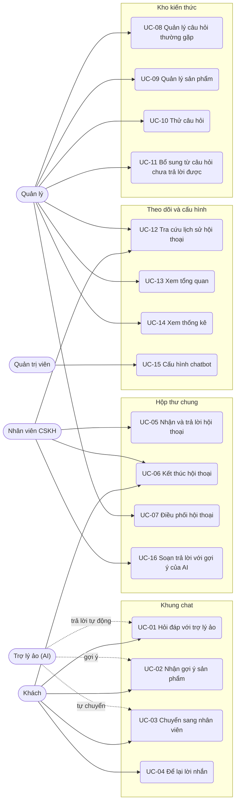
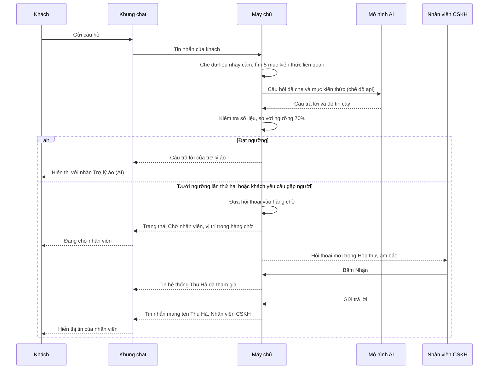

# Đặc tả use case — Chatbot Chăm sóc Khách hàng

> Use case phần nền (UC-SYS-01 đến UC-SYS-10): `ZDOCS/03-KIEN-TRUC/USE-CASE-NEN.md`.
> Mã FR, BR, SCR tham chiếu `02-SRS.md`.

---

## 1. Tác nhân

| Tác nhân | Mã vai trò | Use case chính |
| :--- | :--- | :--- |
| Khách | — | UC-01, UC-02, UC-03, UC-04, UC-06 (kết thúc, đánh giá) |
| Trợ lý ảo (tác nhân hệ thống) | — | UC-01, UC-02, UC-03 (tự chuyển) |
| Nhân viên CSKH | `STAFF` | UC-05, UC-06, UC-12, UC-16 |
| Quản lý | `MANAGER` | UC-05 (khi cần), UC-07, UC-08, UC-09, UC-10, UC-11, UC-12, UC-13, UC-14 |
| Quản trị viên | `ADMIN` | UC-15, toàn bộ use case trên, cộng phần nền |

---

## 2. Sơ đồ use case

---

## 3. Danh sách use case

| Mã | Tên | Tác nhân chính | Module | Ưu tiên | FR |
| :--- | :--- | :--- | :--- | :---: | :--- |
| UC-01 | Hỏi đáp với trợ lý ảo | Khách | Khung chat | P1 | FR-03, FR-04, FR-05, FR-06, FR-07, FR-09, FR-10, FR-11, FR-12, FR-13, FR-15, FR-16 |
| UC-02 | Nhận gợi ý sản phẩm | Khách | Khung chat | P1 | FR-14 |
| UC-03 | Chuyển sang nhân viên | Khách | Khung chat | P1 | FR-06, FR-08, FR-17, FR-18 |
| UC-04 | Để lại lời nhắn | Khách | Khung chat | P1 | FR-19 |
| UC-05 | Nhận và trả lời hội thoại | Nhân viên CSKH | Hộp thư chung | P1 | FR-06, FR-20, FR-21, FR-22, FR-23, FR-24, FR-26 |
| UC-06 | Kết thúc hội thoại | Nhân viên CSKH | Hộp thư chung | P1 | FR-09, FR-25 |
| UC-07 | Điều phối hội thoại | Quản lý | Hộp thư chung | P2 | FR-26, FR-27 |
| UC-08 | Quản lý câu hỏi thường gặp | Quản lý | Kho kiến thức | P1 | FR-29, FR-31, FR-34 |
| UC-09 | Quản lý sản phẩm | Quản lý | Kho kiến thức | P1 | FR-30, FR-31 |
| UC-10 | Thử câu hỏi | Quản lý | Kho kiến thức | P2 | FR-32 |
| UC-11 | Bổ sung từ câu hỏi chưa trả lời được | Quản lý | Kho kiến thức | P2 | FR-33 |
| UC-12 | Tra cứu lịch sử hội thoại | Quản lý, Nhân viên CSKH | Theo dõi và cấu hình | P2 | FR-35 |
| UC-13 | Xem tổng quan | Quản lý | Theo dõi và cấu hình | P1 | FR-01, FR-02 |
| UC-14 | Xem thống kê | Quản lý | Theo dõi và cấu hình | P2 | FR-36, FR-37, FR-38 |
| UC-15 | Cấu hình chatbot | Quản trị viên | Theo dõi và cấu hình | P1 | FR-39, FR-40 |
| UC-16 | Soạn trả lời với gợi ý của AI | Nhân viên CSKH | Hộp thư chung | P3 | FR-28 |

---

## 4. Đặc tả chi tiết

### UC-01: Hỏi đáp với trợ lý ảo

| Mục | Nội dung |
| :--- | :--- |
| Tác nhân chính | Khách |
| Tác nhân phụ | Trợ lý ảo |
| Mô tả | Khách hỏi về giao hàng, đổi trả, bảo hành, thanh toán, cửa hàng; trợ lý ảo trả lời dựa trên kho kiến thức |
| Ưu tiên | P1 |
| Điều kiện kích hoạt | Khách có thắc mắc khi xem website |
| Tiền điều kiện | Website mẫu đang mở; kho kiến thức có ít nhất một mục đang dùng |
| Hậu điều kiện | Hội thoại ở trạng thái "Trợ lý ảo đang trả lời", có mã theo BR-01; mỗi câu trả lời lưu nguồn, độ tin cậy, chế độ |
| Yêu cầu liên quan | FR-03 đến FR-07, FR-09 đến FR-13, FR-15, FR-16, BR-01 đến BR-09, BR-18, BR-20, BR-21 |
| Màn hình | SCR-02, SCR-03 |

**Luồng chính**

1. Khách bấm nút chat ở góc dưới bên phải website mẫu.
2. Hệ thống mở khung chat, hiển thị lời chào "Xin chào anh/chị! Em là trợ lý ảo (AI) của Gia Dụng Hòa An. Cần gặp nhân viên, anh/chị bấm Gặp nhân viên ở phía trên nhé." và 4 nút gợi ý: "Phí giao hàng", "Chính sách đổi trả", "Bảo hành", "Tư vấn chọn nồi chiên".
3. Khách gõ câu hỏi hoặc bấm một nút gợi ý.
4. Hệ thống tạo hội thoại nếu đây là tin đầu tiên, che dữ liệu nhạy cảm (BR-09), hiển thị tin của khách và dòng "Trợ lý ảo đang soạn trả lời…".
5. Hệ thống tìm mục kiến thức phù hợp và tính độ tin cậy: chế độ `mock` so khớp theo kịch bản; chế độ `api` gửi câu hỏi tới mô hình AI theo BR-21 rồi kiểm tra số liệu theo BR-05.
6. Độ tin cậy đạt ngưỡng (BR-03): trợ lý ảo trả lời không quá 120 từ, gắn nhãn "Trợ lý ảo (AI)", kèm nút "Hữu ích" và "Chưa hữu ích".
7. Khách đọc và hỏi tiếp; lặp lại bước 3–6.

**Luồng thay thế**

- 3a. Khách gõ không dấu hoặc viết tắt ("phi ship bao nhieu", "bh bao lâu"): hệ thống chuẩn hóa trước khi so khớp, tiếp tục bước 4.
- 5a. Khách hỏi chọn mua, so sánh sản phẩm: chuyển sang UC-02.
- 5b. Câu hỏi ngoài phạm vi (BR-08): trợ lý ảo trả lời "Dạ, em chỉ hỗ trợ được các câu hỏi về sản phẩm, giao hàng, đổi trả, bảo hành, thanh toán và cửa hàng Gia Dụng Hòa An. Anh/chị cần em giúp gì về những nội dung này ạ?".
- 5c. Tin nhắn có cụm yêu cầu gặp người hoặc từ khóa khiếu nại (BR-10): chuyển sang UC-03.
- 6a. Dưới ngưỡng lần đầu: trợ lý ảo trả lời "Em chưa có thông tin chính xác về câu hỏi này. Anh/chị có thể hỏi theo cách khác, hoặc bấm Gặp nhân viên để được hỗ trợ."; câu hỏi được ghi vào danh sách câu hỏi chưa trả lời được (BR-20).
- 6b. Dưới ngưỡng lần thứ hai liên tiếp, hoặc hội thoại đạt 30 câu trả lời của trợ lý ảo: chuyển sang UC-03.
- 7a. Khách tải lại trang hoặc sang trang khác của website mẫu: khung chat mở lại đúng hội thoại cùng toàn bộ tin nhắn (BR-02).
- 7b. Khách bấm "Chưa hữu ích": hệ thống ghi nhận, trợ lý ảo hỏi "Anh/chị có muốn gặp nhân viên không?" kèm nút "Gặp nhân viên".

**Luồng ngoại lệ**

- E1. Tin nhắn dài quá 1.000 ký tự: nút Gửi bị khóa, bộ đếm ký tự chuyển đỏ.
- E2. Khách gửi quá 10 tin trong 1 phút: ô nhập khóa 60 giây, hiện "Anh/chị nhắn hơi nhanh, vui lòng chờ 60 giây" (BR-07).
- E3. Tin có số thẻ, số CCCD, mã OTP: hệ thống che theo BR-09, hiện nhắc "Vì an toàn, anh/chị không gửi số thẻ, mật khẩu, mã OTP qua chat"; trợ lý ảo không nhắc lại phần đã che.
- E4. Chế độ `api`, mô hình AI lỗi hoặc quá 15 giây: hệ thống dùng kịch bản dự phòng (BR-21); khách không thấy thông báo lỗi kỹ thuật.
- E5. Mất kết nối khi gửi: tin của khách hiện "Chưa gửi được" và nút "Gửi lại"; gửi lại không tạo tin trùng.

### UC-02: Nhận gợi ý sản phẩm

| Mục | Nội dung |
| :--- | :--- |
| Tác nhân chính | Khách |
| Tác nhân phụ | Trợ lý ảo |
| Mô tả | Trợ lý ảo tư vấn sản phẩm phù hợp nhu cầu và mức giá của khách |
| Ưu tiên | P1 |
| Điều kiện kích hoạt | Khách hỏi nên mua loại nào, so sánh, hỏi giá sản phẩm |
| Tiền điều kiện | Hội thoại đang ở trạng thái "Trợ lý ảo đang trả lời" |
| Hậu điều kiện | Câu trả lời lưu danh sách sản phẩm đã gợi ý; lượt bấm thẻ được ghi nhận |
| Yêu cầu liên quan | FR-14, BR-04, BR-06, BR-17 |
| Màn hình | SCR-03, SCR-02 |

**Luồng chính**

1. Khách hỏi theo nhu cầu, vd "Nhà 4 người nên mua nồi chiên nào, tầm 2 triệu?".
2. Hệ thống nhận ra nhu cầu mua hàng (cụm "nên mua", "loại nào", "tư vấn", "chọn giúp"), danh mục ("nồi chiên"), số người, mức giá; lọc sản phẩm theo BR-17.
3. Trợ lý ảo trả lời một đoạn ngắn nêu lý do gợi ý, kèm tối đa 3 thẻ sản phẩm: ảnh, tên, giá (giá khuyến mãi và giá niêm yết gạch ngang nếu có), nút "Xem chi tiết".
4. Khách bấm "Xem chi tiết"; hệ thống ghi lượt bấm và mở link sản phẩm (dữ liệu mẫu trỏ tới sản phẩm đó trên website mẫu).

**Luồng thay thế**

- 1a. Khách hỏi đích danh, vd "Nồi chiên HA-AF55 giá bao nhiêu?": trợ lý ảo nêu đúng giá trong kho kiến thức, kèm 1 thẻ sản phẩm.
- 1b. Khách hỏi so sánh hai sản phẩm: trợ lý ảo nêu thông số chính của từng sản phẩm lấy từ kho kiến thức, kèm 2 thẻ.
- 2a. Sản phẩm khách hỏi đích danh đang "Tạm hết hàng": trợ lý ảo nói rõ "Tạm hết hàng" và gợi ý sản phẩm thay thế còn hàng cùng danh mục.
- 2b. Sản phẩm khách hỏi đích danh đã "Ngừng bán": trợ lý ảo trả lời cửa hàng không còn kinh doanh sản phẩm này, không nêu giá.

**Luồng ngoại lệ**

- E1. Sản phẩm không có trong kho kiến thức (vd máy rửa chén) hoặc không có sản phẩm nào khớp: trợ lý ảo không nêu tên hay giá nào ngoài kho kiến thức, xử lý như dưới ngưỡng (UC-01 bước 6a).
- E2. Khách mặc cả, xin giảm thêm: trợ lý ảo chỉ nêu khuyến mãi có trong kho kiến thức, không tự hứa giảm giá (BR-04), mời gặp nhân viên.
- E3. Khách muốn đặt hàng qua chat: trợ lý ảo hướng dẫn đặt trên website hoặc gặp nhân viên; đặt hàng qua chat ngoài phạm vi demo.

### UC-03: Chuyển sang nhân viên

| Mục | Nội dung |
| :--- | :--- |
| Tác nhân chính | Khách |
| Tác nhân phụ | Trợ lý ảo (tự chuyển), Nhân viên CSKH |
| Mô tả | Đưa hội thoại từ trợ lý ảo vào hàng chờ để nhân viên tiếp nhận |
| Ưu tiên | P1 |
| Điều kiện kích hoạt | Một trong các điều kiện của BR-10 |
| Tiền điều kiện | Hội thoại ở trạng thái "Trợ lý ảo đang trả lời" |
| Hậu điều kiện | Hội thoại ở trạng thái "Chờ nhân viên", có lý do chuyển và mức ưu tiên |
| Yêu cầu liên quan | FR-06, FR-08, FR-17, FR-18, BR-07, BR-10, BR-11, BR-12, BR-16 |
| Màn hình | SCR-03, SCR-04 |

**Luồng chính**

1. Khách bấm "Gặp nhân viên" hoặc nhắn "Cho mình gặp nhân viên".
2. Hệ thống kiểm tra giờ làm việc và nhân viên sẵn sàng (BR-11).
3. Hệ thống đưa hội thoại vào hàng chờ, mức ưu tiên Thường, lý do "Khách yêu cầu"; trạng thái chuyển "Chờ nhân viên".
4. Khung chat hiện tin hệ thống "Em đã chuyển anh/chị tới nhân viên CSKH. Anh/chị đang ở vị trí 2 trong hàng chờ."; tiêu đề đổi thành "Đang chờ nhân viên"; nút "Gặp nhân viên" ẩn.
5. Hộp thư chung phát âm báo, số đếm trên menu tăng, hội thoại xuất hiện ở tab "Chờ nhận".
6. Khi nhân viên nhận (UC-05), khung chat hiện "Nguyễn Thu Hà – Nhân viên CSKH đã tham gia trò chuyện", tiêu đề đổi thành tên nhân viên.

**Luồng thay thế**

- 1a. Hệ thống tự chuyển theo BR-10 (b), (c), (d): trợ lý ảo nói rõ lý do, vd với khiếu nại "Em rất tiếc về sự cố anh/chị gặp phải. Em chuyển anh/chị tới nhân viên CSKH để xử lý ngay ạ."; hội thoại khiếu nại có mức ưu tiên Khẩn và đứng đầu hàng chờ.
- 2a. Ngoài giờ làm việc hoặc không có nhân viên sẵn sàng: chuyển sang UC-04.
- 4a. Chờ quá 2 phút: khung chat nhận một tin "Nhân viên đang bận, anh/chị vui lòng chờ thêm ít phút". Chờ quá 5 phút: khung chat hiện thêm nút "Để lại lời nhắn" (UC-04), quản lý nhận thông báo (BR-12).
- 4b. Khách bấm "Quay lại trợ lý ảo": hội thoại rời hàng chờ, trở về "Trợ lý ảo đang trả lời"; khung chat hiện tin hệ thống "Anh/chị đang trò chuyện với trợ lý ảo (AI)".
- 4c. Trong lúc chờ, khách nhắn thêm: tin được lưu cho nhân viên đọc, trợ lý ảo không trả lời.

**Luồng ngoại lệ**

- E1. Hội thoại đã ở trạng thái "Chờ nhân viên" hoặc "Nhân viên đang xử lý": nút "Gặp nhân viên" không hiển thị, cụm "gặp nhân viên" trong tin nhắn không tạo yêu cầu mới.

### UC-04: Để lại lời nhắn

| Mục | Nội dung |
| :--- | :--- |
| Tác nhân chính | Khách |
| Mô tả | Khách để lại thông tin liên hệ khi không có nhân viên trực, nhân viên xử lý vào ca kế tiếp |
| Ưu tiên | P1 |
| Điều kiện kích hoạt | Cần chuyển nhân viên khi ngoài giờ làm việc hoặc không có nhân viên sẵn sàng; hoặc khách chờ quá 5 phút |
| Tiền điều kiện | Hội thoại ở trạng thái "Trợ lý ảo đang trả lời" hoặc "Chờ nhân viên" quá 5 phút |
| Hậu điều kiện | Hội thoại "Chờ nhân viên" có nhãn "Ngoài giờ", có lời nhắn và hạn nhận |
| Yêu cầu liên quan | FR-19, BR-09, BR-11, BR-13 |
| Màn hình | SCR-03, SCR-04 |

**Luồng chính**

1. Lúc 22:15, khách nhắn "Cho mình gặp nhân viên".
2. Trợ lý ảo trả lời "Hiện ngoài giờ làm việc của nhân viên CSKH (08:00–21:00). Anh/chị để lại lời nhắn, nhân viên sẽ liên hệ trong giờ làm việc kế tiếp ạ." kèm biểu mẫu lời nhắn.
3. Khách nhập họ tên, số điện thoại, nội dung, tick "Tôi đồng ý để Gia Dụng Hòa An liên hệ lại qua số điện thoại này".
4. Khách bấm "Gửi lời nhắn"; hệ thống kiểm tra BR-13, lưu lời nhắn, đưa hội thoại vào hàng chờ với nhãn "Ngoài giờ", hạn nhận 09:00 sáng hôm sau.
5. Khung chat xác nhận "Đã nhận lời nhắn. Nhân viên sẽ liên hệ anh/chị trước 09:00 ngày mai."
6. Đầu ca kế tiếp, hội thoại hiện ở tab "Chờ nhận" của hộp thư, có nhãn "Ngoài giờ" và hạn nhận.

**Luồng thay thế**

- 2a. Trong giờ nhưng không có nhân viên sẵn sàng: câu mở đầu đổi thành "Hiện các nhân viên CSKH đều đang bận…", phần còn lại như trên; hạn nhận là 60 phút kể từ lúc gửi lời nhắn (BR-13).
- 2b. Khách chờ quá 5 phút ở UC-03 rồi bấm "Để lại lời nhắn": hiện biểu mẫu như bước 3; hội thoại vẫn trong hàng chờ, có thêm lời nhắn.
- 3a. Khách bỏ qua biểu mẫu và hỏi tiếp: hội thoại giữ trạng thái "Trợ lý ảo đang trả lời", trợ lý ảo trả lời bình thường.

**Luồng ngoại lệ**

- E1. Số điện thoại sai định dạng (không đủ 10 số, đầu số không hợp lệ): báo lỗi tại ô, không gửi.
- E2. Chưa tick ô đồng ý: nút "Gửi lời nhắn" bị khóa.
- E3. Nội dung lời nhắn có số thẻ, số CCCD: hệ thống che theo BR-09 trước khi lưu.

### UC-05: Nhận và trả lời hội thoại

| Mục | Nội dung |
| :--- | :--- |
| Tác nhân chính | Nhân viên CSKH |
| Mô tả | Nhân viên nhận hội thoại từ hàng chờ và trò chuyện với khách |
| Ưu tiên | P1 |
| Điều kiện kích hoạt | Có hội thoại mới trong hàng chờ |
| Tiền điều kiện | Có quyền `conversations.handle`; nhân viên đang xử lý dưới 5 hội thoại (BR-14) |
| Hậu điều kiện | Hội thoại ở trạng thái "Nhân viên đang xử lý", gán cho nhân viên; khách thấy rõ đang trò chuyện với người |
| Yêu cầu liên quan | FR-06, FR-20 đến FR-24, FR-26, BR-02, BR-12, BR-13, BR-14, BR-16 |
| Màn hình | SCR-04 |

**Luồng chính**

1. Nhân viên đăng nhập; hệ thống mở Hộp thư chung, tab "Chờ nhận". Mỗi dòng có mã hội thoại, tên khách, câu hỏi gần nhất, lý do chuyển, mức ưu tiên, thời gian chờ, màu theo hạn chờ.
2. Nhân viên chọn hội thoại đầu hàng chờ, bấm "Nhận".
3. Hệ thống gán hội thoại cho nhân viên, chuyển "Nhân viên đang xử lý", gửi tin hệ thống cho khách (BR-16).
4. Hệ thống hiển thị khung hội thoại: toàn bộ lịch sử, phần của trợ lý ảo có nhãn "AI" kèm nguồn và độ tin cậy; cột phải có thông tin khách, lý do chuyển, lời nhắn nếu có.
5. Nhân viên soạn và gửi trả lời; khách nhận ngay, tin mang tên "Nguyễn Thu Hà – Nhân viên CSKH".
6. Lặp lại bước 5 tới khi xong việc, sau đó kết thúc theo UC-06.

**Luồng thay thế**

- 1a. Có hội thoại mới vào hàng chờ khi nhân viên đang ở trang khác: âm báo, số đếm trên menu Hộp thư tăng.
- 5a. Tra kho kiến thức: bấm "Kho kiến thức" cạnh ô soạn, gõ từ khóa, chọn mục, bấm "Chèn"; câu trả lời của mục được chèn vào ô soạn để sửa trước khi gửi.
- 5b. Gắn nhãn chủ đề và ghi chú nội bộ ở cột phải; khách không thấy ghi chú.
- 5c. Hội thoại có lời nhắn ngoài giờ: nhân viên gọi lại khách bằng điện thoại, ghi chú kết quả, đóng hội thoại với kết quả "Đã giải quyết" hoặc "Hẹn liên hệ lại".
- 5d. Nhân viên chuyển sang "Tạm vắng": hệ thống không tính nhân viên này khi quyết định vào hàng chờ hay để lại lời nhắn (BR-11); các hội thoại đang xử lý giữ nguyên.

**Luồng ngoại lệ**

- E1. Nhân viên đang xử lý đủ 5 hội thoại: nút "Nhận" bị khóa, chú thích "Đã đủ 5 hội thoại đang xử lý".
- E2. Người khác nhận trước: hệ thống báo "Hội thoại đã được Trần Minh Quân nhận", dòng biến khỏi tab "Chờ nhận".
- E3. Tin nhắn quá 2.000 ký tự: nút Gửi bị khóa.
- E4. Khách đã rời trang: tin vẫn được gửi và lưu; khách thấy khi mở lại website lúc hội thoại chưa đóng.

### UC-06: Kết thúc hội thoại

| Mục | Nội dung |
| :--- | :--- |
| Tác nhân chính | Nhân viên CSKH |
| Tác nhân phụ | Khách, hệ thống (tự đóng) |
| Mô tả | Đóng hội thoại với kết quả xử lý và mời khách đánh giá |
| Ưu tiên | P1 |
| Điều kiện kích hoạt | Đã giải đáp xong; khách bấm kết thúc; hoặc khách im lặng quá thời gian quy định |
| Tiền điều kiện | Hội thoại chưa đóng; với nhân viên: hội thoại do mình phụ trách |
| Hậu điều kiện | Hội thoại "Đã đóng", có kết quả, thời điểm đóng, người đóng; khách nhắn tiếp thì tạo hội thoại mới |
| Yêu cầu liên quan | FR-09, FR-25, BR-01, BR-15, BR-24 |
| Màn hình | SCR-04, SCR-03 |

**Luồng chính**

1. Nhân viên bấm "Đóng hội thoại".
2. Hệ thống yêu cầu chọn kết quả: Đã giải quyết, Hẹn liên hệ lại, Khách không phản hồi.
3. Nhân viên chọn kết quả, xác nhận; hệ thống chuyển hội thoại sang "Đã đóng", ghi thời điểm và người đóng.
4. Khung chat của khách hiện "Cuộc trò chuyện đã kết thúc" và mời đánh giá 1–5 sao.
5. Khách chọn số sao, nhập góp ý nếu muốn, bấm "Gửi đánh giá".

**Luồng thay thế**

- 1a. Khách bấm "Kết thúc trò chuyện": hệ thống đóng với kết quả "Khách kết thúc", tiếp tục bước 4.
- 1b. Khách không nhắn trong 30 phút: hệ thống tự đóng với kết quả "Khách không phản hồi" (BR-15); với hội thoại nhân viên đang xử lý, hộp thư nhắc nhân viên 5 phút trước khi đóng.
- 5a. Khách bỏ qua đánh giá: hội thoại vẫn đóng, không có điểm.
- 5b. Khách chọn 1–2 sao: hệ thống gắn nhãn "Cần xem lại" (BR-24).
- 5c. Khách nhắn tiếp sau khi đóng: hệ thống tạo hội thoại mới với mã mới, hội thoại cũ hiển thị phía trên ở dạng chỉ đọc (BR-02).

**Luồng ngoại lệ**

- E1. Hội thoại đang ở tab "Chờ nhận": không có nút "Đóng hội thoại"; nhân viên phải nhận trước.
- E2. Khách đánh giá sau 24 giờ kể từ khi đóng: phần đánh giá không còn hiển thị.

### UC-07: Điều phối hội thoại

| Mục | Nội dung |
| :--- | :--- |
| Tác nhân chính | Quản lý |
| Mô tả | Theo dõi hàng chờ, chia lại hội thoại giữa các nhân viên |
| Ưu tiên | P2 |
| Yêu cầu liên quan | FR-26, FR-27, BR-14 |
| Màn hình | SCR-04 |

**Luồng chính**

1. Quản lý mở Hộp thư, tab "Đang mở"; hệ thống hiển thị mọi hội thoại đang chờ và đang xử lý kèm nhân viên phụ trách, cùng danh sách nhân viên với trạng thái Sẵn sàng/Tạm vắng và số hội thoại mỗi người đang xử lý.
2. Quản lý chọn hội thoại, bấm "Chuyển", chọn nhân viên nhận (đang xử lý dưới 5 hội thoại), nhập lý do.
3. Hệ thống đổi người phụ trách; khung chat của khách hiện tin hệ thống "Lê Hoàng Nam – Nhân viên CSKH đã tiếp nhận cuộc trò chuyện"; nhân viên mới nhận thông báo.
4. Hoặc quản lý bấm "Trả về hàng chờ": hội thoại quay về tab "Chờ nhận", giữ nguyên thời điểm vào hàng chờ ban đầu.

### UC-08: Quản lý câu hỏi thường gặp

| Mục | Nội dung |
| :--- | :--- |
| Tác nhân chính | Quản lý |
| Mô tả | Thêm, sửa, tạm ẩn câu hỏi thường gặp mà trợ lý ảo dùng để trả lời |
| Ưu tiên | P1 |
| Điều kiện kích hoạt | Cửa hàng đổi chính sách, có khuyến mãi mới, phát hiện câu hỏi khách hay hỏi |
| Tiền điều kiện | Có quyền `faqs.create` hoặc `faqs.update` |
| Hậu điều kiện | Trợ lý ảo dùng nội dung mới ngay từ câu hỏi kế tiếp của khách |
| Yêu cầu liên quan | FR-29, FR-31, FR-34, BR-06, BR-18, BR-19 |
| Màn hình | SCR-05 |

**Luồng chính**

1. Quản lý mở Kho kiến thức, tab "Câu hỏi thường gặp"; hệ thống hiển thị danh sách có mã, nhóm chủ đề, câu hỏi chính, trạng thái, hiệu lực, số lần dùng trong 30 ngày.
2. Quản lý bấm "Thêm câu hỏi".
3. Chọn nhóm chủ đề; nhập câu hỏi chính, các cách hỏi khác (mỗi dòng một câu), từ khóa, câu trả lời, link tham khảo, thời gian hiệu lực (không bắt buộc).
4. Bấm "Lưu"; hệ thống kiểm tra BR-06, BR-18, cấp mã `FAQ` + 3 số, trạng thái "Đang dùng".
5. Câu hỏi mới xuất hiện trong danh sách; trợ lý ảo dùng ngay.

**Luồng thay thế**

- 1a. Tìm theo nội dung, lọc theo nhóm chủ đề, trạng thái, còn hiệu lực hay hết hiệu lực.
- 1b. Sửa: chọn câu hỏi, đổi nội dung, lưu; câu trả lời cũ trong lịch sử hội thoại giữ nguyên.
- 1c. Tạm ẩn hoặc dùng lại: bật tắt công tắc "Đang dùng".
- 1d. Nhập từ Excel theo file mẫu (P3).
- 4a. Bấm "Lưu và thử": lưu xong mở hộp thử câu hỏi (UC-10) với sẵn câu hỏi chính.

**Luồng ngoại lệ**

- E1. Câu hỏi chính trùng với câu đã có: báo lỗi tại ô câu hỏi.
- E2. Câu trả lời trống hoặc quá 600 ký tự, hoặc quá 10 cách hỏi khác: báo lỗi, không lưu.
- E3. Ngày kết thúc hiệu lực trước ngày bắt đầu: báo lỗi.
- E4. Xóa câu hỏi đã từng được dùng để trả lời: hệ thống từ chối, gợi ý dùng "Tạm ẩn" (BR-19).

### UC-09: Quản lý sản phẩm

| Mục | Nội dung |
| :--- | :--- |
| Tác nhân chính | Quản lý |
| Mô tả | Cập nhật sản phẩm, giá, tình trạng hàng để trợ lý ảo tư vấn đúng |
| Ưu tiên | P1 |
| Điều kiện kích hoạt | Có sản phẩm mới, đổi giá, hết hàng, ngừng bán |
| Tiền điều kiện | Có quyền `products.create` hoặc `products.update` |
| Hậu điều kiện | Trợ lý ảo gợi ý theo dữ liệu mới từ câu hỏi kế tiếp |
| Yêu cầu liên quan | FR-30, FR-31, BR-17, BR-18, BR-19 |
| Màn hình | SCR-05 |

**Luồng chính**

1. Quản lý mở Kho kiến thức, tab "Sản phẩm"; hệ thống hiển thị danh sách có ảnh, mã, tên, danh mục, giá bán, tình trạng hàng, trạng thái, số lần được gợi ý trong 30 ngày.
2. Bấm "Thêm sản phẩm".
3. Nhập mã, tên, chọn danh mục, giá niêm yết, giá khuyến mãi (không bắt buộc), mô tả ngắn, thông số chính, chọn nhóm khách phù hợp (vd "1–2 người", "3–5 người", "4–6 người"), thời hạn bảo hành, tải ảnh, nhập link.
4. Bấm "Lưu"; hệ thống kiểm tra BR-18, lưu với tình trạng "Còn hàng", trạng thái "Đang bán".

**Luồng thay thế**

- 1a. Báo tạm hết hàng: bật công tắc "Tạm hết hàng" trên dòng sản phẩm; trợ lý ảo ngừng gợi ý sản phẩm này (BR-17).
- 1b. Ngừng bán: chọn sản phẩm, bấm "Ngừng bán", xác nhận.
- 1c. Sửa giá hoặc thông tin: chọn sản phẩm, sửa, lưu.

**Luồng ngoại lệ**

- E1. Mã sản phẩm trùng: báo lỗi tại ô mã.
- E2. Giá không phải bội số 1.000 ₫, hoặc giá khuyến mãi lớn hơn hay bằng giá niêm yết: báo lỗi, không lưu.
- E3. Xóa sản phẩm đã từng được gợi ý: hệ thống từ chối, gợi ý dùng "Ngừng bán" (BR-19).

### UC-10: Thử câu hỏi

| Mục | Nội dung |
| :--- | :--- |
| Tác nhân chính | Quản lý |
| Mô tả | Kiểm tra trước trợ lý ảo sẽ trả lời khách thế nào |
| Ưu tiên | P2 |
| Yêu cầu liên quan | FR-32, BR-03 |
| Màn hình | SCR-06 |

**Luồng chính**

1. Quản lý bấm "Thử câu hỏi" ở Kho kiến thức; hệ thống mở bảng bên giống khung chat của khách.
2. Quản lý gõ câu hỏi; hệ thống trả lời đúng như khách sẽ nhận, kèm mục kiến thức nguồn (bấm để mở), độ tin cậy, chế độ trả lời, thời gian xử lý.
3. Câu trả lời chưa đúng ý thì quản lý sửa mục kiến thức hoặc thêm cách hỏi khác, rồi thử lại.

Lần thử không tạo hội thoại, không ghi câu hỏi chưa trả lời được, không tính vào thống kê. Ở chế độ `api`, lần thử vẫn gọi mô hình AI và phát sinh chi phí.

### UC-11: Bổ sung từ câu hỏi chưa trả lời được

| Mục | Nội dung |
| :--- | :--- |
| Tác nhân chính | Quản lý |
| Mô tả | Biến những câu trợ lý ảo chưa trả lời được thành kiến thức mới |
| Ưu tiên | P2 |
| Yêu cầu liên quan | FR-33, BR-20 |
| Màn hình | SCR-05 |

**Luồng chính**

1. Quản lý mở Kho kiến thức, tab "Cần bổ sung"; hệ thống hiển thị các câu trạng thái "Mới", sắp theo số lần hỏi giảm dần, có lần hỏi gần nhất và link tới hội thoại.
2. Quản lý chọn câu "Shop có nhận làm đại lý không?" (5 lần), bấm "Tạo câu hỏi thường gặp".
3. Hệ thống mở biểu mẫu của UC-08, điền sẵn câu hỏi chính và các cách hỏi khác từ những câu đã gộp.
4. Quản lý nhập câu trả lời, lưu; câu hỏi chuyển "Đã bổ sung", liên kết với câu hỏi thường gặp mới.

**Luồng thay thế**

- 2a. Bấm "Thêm vào câu hỏi có sẵn": chọn câu hỏi thường gặp đã có, câu này được thêm làm cách hỏi khác.
- 2b. Bấm "Bỏ qua" với câu vô nghĩa hoặc không cần trả lời.

### UC-12: Tra cứu lịch sử hội thoại

| Mục | Nội dung |
| :--- | :--- |
| Tác nhân chính | Quản lý, Nhân viên CSKH |
| Mô tả | Tìm và xem lại hội thoại cũ, kiểm tra trợ lý ảo đã trả lời gì, dựa trên nguồn nào |
| Ưu tiên | P2 |
| Yêu cầu liên quan | FR-35, BR-01 |
| Màn hình | SCR-07, SCR-08 |

**Luồng chính**

1. Mở Lịch sử hội thoại; mặc định hiển thị 7 ngày gần nhất. Quản lý thấy mọi hội thoại, nhân viên chỉ thấy hội thoại mình đã xử lý.
2. Tìm theo mã hoặc nội dung tin nhắn; lọc theo trạng thái, có chuyển nhân viên, nhân viên xử lý, nhãn, điểm đánh giá.
3. Chọn hội thoại; hệ thống hiển thị toàn bộ tin nhắn theo thời gian, nhãn người gửi, nguồn và độ tin cậy của từng câu trả lời AI, đánh giá của khách, các mốc (bắt đầu, vào hàng chờ, nhận, đóng), nhãn, ghi chú nội bộ.

### UC-13: Xem tổng quan

| Mục | Nội dung |
| :--- | :--- |
| Tác nhân chính | Quản lý |
| Mô tả | Nắm nhanh tình hình chăm sóc khách hàng hôm nay |
| Ưu tiên | P1 |
| Điều kiện kích hoạt | Quản lý đăng nhập hoặc bấm menu Tổng quan |
| Tiền điều kiện | Có quyền `reports.view` |
| Hậu điều kiện | Không thay đổi dữ liệu |
| Yêu cầu liên quan | FR-01, FR-02, BR-12, BR-22, BR-23 |
| Màn hình | SCR-01 |

**Luồng chính**

1. Quản lý đăng nhập; hệ thống mở trang Tổng quan.
2. Hệ thống hiển thị 5 thẻ số: hội thoại hôm nay, tỉ lệ AI tự giải quyết, đang chờ nhân viên (số quá hạn tô đỏ), thời gian chờ trung bình, điểm đánh giá trung bình. Thẻ số hội thoại và các thẻ tỉ lệ có mức tăng giảm so với cùng giờ hôm qua.
3. Hệ thống hiển thị biểu đồ cột chồng số hội thoại theo giờ (AI tự giải quyết, chuyển nhân viên) và bảng top 5 nhóm chủ đề hôm nay.
4. Số liệu tự làm mới mỗi 60 giây.

**Luồng thay thế**

- 2a. Bấm thẻ "Đang chờ nhân viên": mở Hộp thư, tab "Đang mở".
- 3a. Bấm một nhóm chủ đề: mở Thống kê, tab Câu hỏi, lọc sẵn nhóm đó.

**Luồng ngoại lệ**

- E1. Hôm nay chưa có hội thoại: các thẻ hiển thị 0, tỉ lệ và điểm hiển thị "—", biểu đồ hiển thị trạng thái trống.
- E2. Người dùng không có quyền `reports.view` (Nhân viên CSKH): menu không có Tổng quan; đăng nhập vào thẳng Hộp thư.

### UC-14: Xem thống kê

| Mục | Nội dung |
| :--- | :--- |
| Tác nhân chính | Quản lý |
| Mô tả | Đo hiệu quả trợ lý ảo, chủ đề khách quan tâm, chất lượng CSKH |
| Ưu tiên | P2 |
| Yêu cầu liên quan | FR-36, FR-37, FR-38, BR-22, BR-23, BR-24 |
| Màn hình | SCR-09 |

**Luồng chính**

1. Quản lý mở Thống kê; mặc định tab Tổng hợp, khoảng 30 ngày gần nhất.
2. Hệ thống hiển thị biểu đồ số hội thoại theo ngày (tách AI tự giải quyết và chuyển nhân viên), đường kỳ trước làm nền, tỉ lệ AI tự giải quyết, số chuyển nhân viên theo lý do, tỉ lệ ngoài giờ.
3. Quản lý đổi khoảng ngày (7 ngày, 30 ngày, Tháng này, Tháng trước, Tùy chọn tối đa 366 ngày); số liệu cập nhật.
4. Chuyển sang tab Câu hỏi, Gợi ý sản phẩm, Chất lượng CSKH, Cần xem lại để xem các báo cáo khác (§6 của SRS).

### UC-15: Cấu hình chatbot

| Mục | Nội dung |
| :--- | :--- |
| Tác nhân chính | Quản trị viên |
| Mô tả | Đặt ngưỡng tin cậy, giờ làm việc CSKH, thời gian tự đóng, lời chào của trợ lý ảo |
| Ưu tiên | P1 |
| Điều kiện kích hoạt | Đổi giờ trực, chỉnh độ chặt của trợ lý ảo, đổi thương hiệu |
| Tiền điều kiện | Có quyền `chatbot-settings.update` |
| Hậu điều kiện | Cấu hình mới áp dụng ngay cho câu hỏi và yêu cầu chuyển nhân viên tiếp theo |
| Yêu cầu liên quan | FR-39, FR-40, BR-03, BR-11, BR-15, BR-16, BR-21 |
| Màn hình | SCR-10 |

**Luồng chính**

1. Quản trị viên mở Cài đặt → Chatbot.
2. Hệ thống hiển thị chế độ trả lời đang chạy (`mock` hoặc `api`), trạng thái kết nối mô hình AI (Đã kết nối, Chưa có API key, Lỗi kết nối), ngưỡng tin cậy, giờ làm việc từng ngày, thời gian tự đóng.
3. Quản trị viên kéo ngưỡng tin cậy (50–90%, bước 5%), bật tắt và sửa giờ bắt đầu, giờ kết thúc của từng ngày, đổi thời gian tự đóng (15–120 phút).
4. Bấm "Lưu"; hệ thống kiểm tra và áp dụng ngay.

**Luồng thay thế**

- 2a. Chế độ `api`: bấm "Kiểm tra kết nối"; hệ thống gửi một câu hỏi mẫu tới mô hình AI và báo thời gian phản hồi.
- 3a. Đổi tên trợ lý ảo, lời chào, tối đa 4 câu hỏi gợi ý (mỗi câu tối đa 40 ký tự), câu mẫu ngoài phạm vi, câu mẫu dưới ngưỡng; khung xem trước cập nhật ngay (P2).

**Luồng ngoại lệ**

- E1. Giờ kết thúc không sau giờ bắt đầu: báo lỗi tại ngày đó, không lưu.
- E2. Câu "Em là trợ lý ảo (AI) của {tên cửa hàng}" trong lời chào là dòng cố định, không sửa, không xóa được (BR-16).
- E3. Chế độ `api` chưa có API key: trạng thái "Chưa có API key", trợ lý ảo chạy bằng kịch bản; API key không nhập trên giao diện, chỉ đặt trong `BE/src/API/.env`.
- E4. Quản lý (chỉ có `chatbot-settings.view`): xem được cấu hình, các ô bị khóa, không có nút "Lưu".
